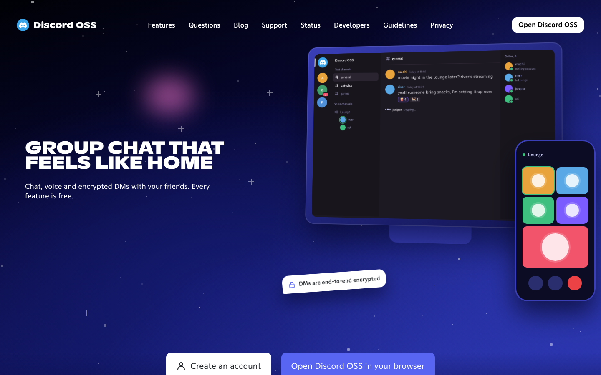
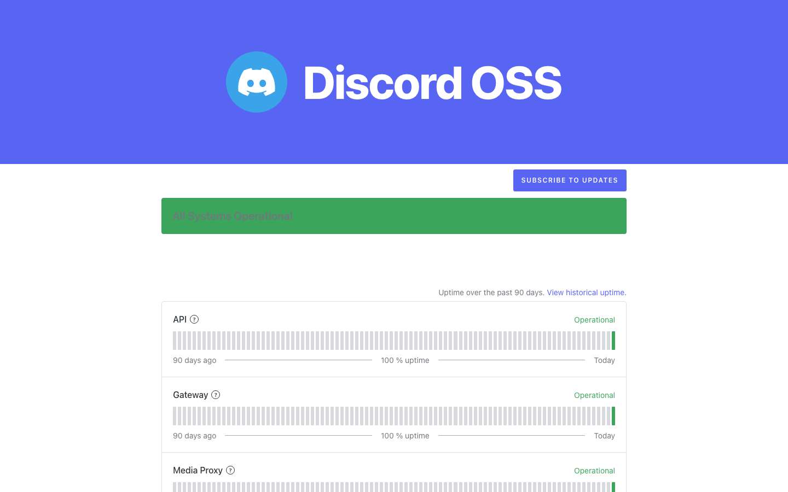

# Discord OSS

Discord OSS is a self-hosted chat server that speaks Discord's REST API, gateway and voice protocol. It serves the official Discord web client from a local cache with [Equicord](https://github.com/Equicord/Equicord) built in, rebranded with your instance's name and icon, so people get the app they already know on a server you run.

It is a fork of [Spacebar](https://github.com/spacebarchat/server), written in TypeScript on Express 5 and TypeORM, and it runs on [Bun](https://bun.sh) with PostgreSQL or SQLite.

> Discord OSS is not made by, affiliated with or endorsed by Discord Inc. Accounts are separate from Discord accounts, and nothing posted on an instance is sent to Discord.



## Features

- **The client you know:** servers, channels, threads, forums, DMs and group DMs, roles and permissions, reactions, stickers, emoji, polls, invites, AutoMod, audit logs, server discovery and the Shop, all in Discord's own web client.
- **Voice and video:** voice channels, video calls, DM calls and Go Live screen sharing through a bundled Go SFU, with Discord's DAVE end-to-end encryption.
- **End-to-end encrypted DMs:** every DM and group DM is encrypted in the browser. Keys are backed up with the account password or a recovery code, and staff can still review reports because the reporter's browser hands over the keys of the reported message and the messages around it, up to 50, and nothing else. See [e2ee.md](docs/features/e2ee.md).
- **Everything is free:** every account has every premium feature, every server is boost level 3, and every Shop item can be claimed for free, including the Orbs Shop. There are no ads, Quests or upsells.
- **Badges:** Discord's levelled Account Age, Streaming, Game Time and Game Variety badges with their artwork and progress, Discord's legacy badges, a Features (Nitro) badge and rarities that admins can set per user, and custom badges. See [badges.md](docs/features/badges.md).
- **Pride flags:** people pick from 85 locally hosted pride flags at signup or in their profile, and the flags show next to their pronouns. See [pride-badges.md](docs/features/pride-badges.md).
- **Your own site:** a landing page, a status page with uptime history and an API response time chart, and a blog and help centre written in the admin dashboard.
- **Admin dashboard:** users, servers, reports, AutoMod and raid protection, staff roles with an audit log, badges, the Shop, the status page, announcements and every setting, at `/admin`.
- **Developer portal:** OAuth2 applications, bots, slash commands and embedded activities, at `/developers`.
- **Mobile:** the web client works in phone browsers and installs to the home screen, and a bundle for Discord's Android app through Kettu points it at your instance. See [phones.md](docs/features/phones.md).

[parity.md](docs/development/parity.md) lists every Discord feature and its state on Discord OSS.

## Run an instance

You need a Linux host with Docker Engine and the Compose plugin, a domain whose DNS record points at the host, a reverse proxy or tunnel that serves that domain over HTTPS (Caddy, nginx or Cloudflare Tunnel, for example), and open UDP port 50000 for voice.

```sh
git clone https://github.com/wypiek/discord-oss.git && cd discord-oss
cp .env.example .env
$EDITOR .env
docker compose up -d --build
docker compose logs -f client
```

In `.env`, set at least `DOMAIN`, `POSTGRES_PASSWORD` and `WRTC_PUBLIC_IP`. On the first start the `client` service downloads the Discord web client, about 300 MB, which takes a few minutes. The server then listens on `127.0.0.1:32171`, set by `SERVER_BIND` and `SERVER_PORT`. Point your proxy or tunnel at it with websocket upgrades and open `https://<your domain>/register`.

The first account has no special rights. To make yourself the operator, turn on Developer Mode in the client, copy your account ID and run:

```sh
docker compose exec server bun scripts/ops/operator.mjs grant <account-id>
```

Then open `https://<your domain>/admin`.

[setup.md](docs/self-hosting/setup.md) covers every environment variable, email, captchas, backups, updates, SQLite and running behind your own proxy. [native.md](docs/self-hosting/native.md) runs Discord OSS without Docker, and [workers.md](docs/self-hosting/workers.md) runs it on Cloudflare Workers.



## Develop

Install Bun 1.4, PostgreSQL, Git and `lsof`. Voice needs Go, and Equicord's own build needs Node.js. Then:

```sh
bun install
bun run generate:client
scripts/dev/worktree-setup.sh 3001 discord_oss_dev
```

`generate:client` downloads the Discord web client into `assets/cache` and builds Equicord with this project's plugins into `assets/vencord`. `worktree-setup.sh` creates a fresh database, writes `.env` and `config.json`, builds and starts the server on port 3001 and seeds two test accounts, whose passwords it saves in `scripts/dev/.test-account`. Open `http://localhost:3001`.

| Command | What it does |
| --- | --- |
| `bun run build:src` | Compiles `src` into `dist`. |
| `PORT=3001 scripts/dev/restart.sh` | Restarts the dev server on the current build. |
| `bun run test` | Runs the unit tests. Build first. |
| `bun run lint`, `bun run format` | Lints and formats with Biome. |
| `PORT=3001 bun scripts/dev/parity-probe.mjs` | Checks about 170 API behaviours against a running server. |
| `bun run build:equicord` | Rebuilds the client plugins after changing `client/plugins`. |

Read [CONTRIBUTING.MD](CONTRIBUTING.MD) before opening a pull request, [client-patches.md](docs/development/client-patches.md) before changing the client and [e2ee.md](docs/features/e2ee.md) before changing encryption.

## How it fits together

| Part | Where |
| --- | --- |
| REST API, admin dashboard and pages | `src/api` |
| Gateway | `src/gateway` |
| CDN | `src/cdn` |
| Voice gateway | `src/webrtc` |
| Media server (SFU) | `extra/pion-sfu` |
| Everything in one process on one port | `src/bundle` |
| Database entities and migrations | `src/database` |
| Equicord plugins that adapt the client | `client/plugins` |
| Encryption engine | `client/e2ee` |
| Android bundle | `client/mobile` |

[docs/README.md](docs/README.md) indexes the rest of the documentation.

## Credits

Discord OSS builds on [Spacebar](https://github.com/spacebarchat/server) and [Meowcord](https://github.com/meowcorded/meowcord), and on [Equicord](https://github.com/Equicord/Equicord) and [Vencord](https://github.com/Vendicated/Vencord) for the client layer. The pride flags come from [b3yc0d3/twemoji-flags](https://github.com/b3yc0d3/twemoji-flags) under CC BY 4.0, with the rest drawn for this project, as [ATTRIBUTION.md](assets/badge-icons/twemoji-flags/ATTRIBUTION.md) records.

Discord's web client and artwork belong to Discord Inc. They are downloaded by each instance at setup and are never part of this repository.

## License

[GNU Affero General Public License v3.0](LICENSE). If you run a modified Discord OSS for other people, you must offer them its source code.
